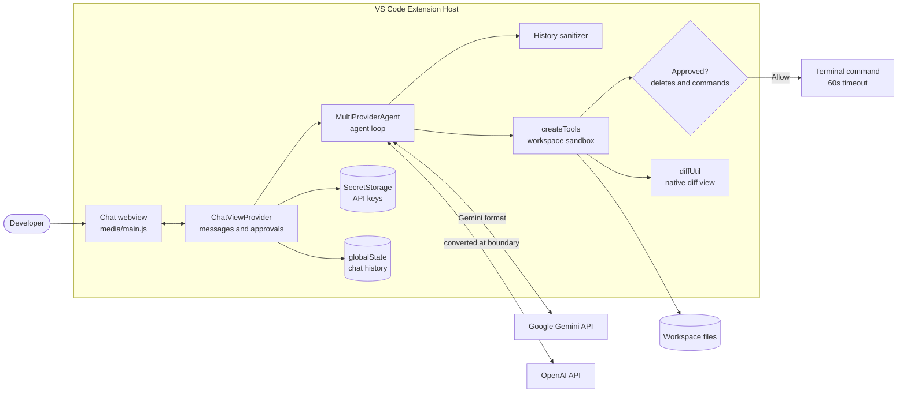

# CodeSense AI

**An AI coding agent for VS Code that reads, changes, and tests your code from a chat sidebar, and asks before it deletes anything or runs a command.**

[](https://github.com/KumarAyushh/CodeSense/actions/workflows/ci.yml)
[](https://marketplace.visualstudio.com/items?itemName=kumarayushh.codesense-ai)
[](https://code.visualstudio.com/)
[](https://nodejs.org/)
[](#supported-providers)
[](LICENSE)

## Overview

Chat assistants can suggest code, but you still have to copy it in, run it, and report back what broke. CodeSense closes that loop: the model explores the workspace, edits files, and runs your tests through tool calls, then uses the real results to decide what to do next.

Giving a model access to your disk and shell is risky, so the project is built around that risk. File access is confined to the workspace, destructive actions need your approval, and commands are time-limited and can be stopped.

CodeSense is published on the [VS Code Marketplace](https://marketplace.visualstudio.com/items?itemName=kumarayushh.codesense-ai), with 400+ downloads and 65+ installs.

## Key Features

- **Runs a multi-step agent loop** of up to 15 model turns per message, feeding each tool result back to the model.
- **Supports Google Gemini and OpenAI** behind one internal conversation format, with the model configurable in VS Code settings.
- **Confines file tools to the workspace**, refusing `../` paths, absolute paths, and symlinks that lead outside it.
- **Requires approval** in a modal showing the exact path or command before any delete or terminal command.
- **Enforces command limits** with a 60-second timeout, output truncation, and a Stop button that kills the whole process tree.
- **Opens a native diff view** after the AI overwrites a file, so you can see exactly what changed.
- **Repairs conversation history** before every request, so an interrupted or trimmed tool call doesn't cause an API error.
- **Stores API keys in VS Code SecretStorage** and sends each key only to the provider it belongs to.
- **Saves up to 50 conversations**, and shows live activity for each tool the agent runs.
- **Hardens the webview** with a nonce-based script policy, escaped output, and `http`/`https`-only links.

## Performance & Optimizations

Before is commit [`1469529`](https://github.com/KumarAyushh/CodeSense/commit/1469529), the last commit before the cleanup work. After is commit [`5699ca1`](https://github.com/KumarAyushh/CodeSense/commit/5699ca1).

| Metric | Before | After | Improvement |
| --- | --- | --- | --- |
| Packaged `.vsix` size | 6.93 MB | 293 KB | 95.9% smaller |
| Files in package | 2,993 | 13 | 99.6% fewer |
| Unpacked install size | 33.02 MB | 0.93 MB | 97.2% smaller |
| Runtime dependency packages | 71 | 28 | 60.6% fewer |
| Runtime `npm audit` findings | 6 (3 high, 3 moderate) | 0 | All resolved |
| Code load time, activation through agent ready | 203 ms | 60 ms | 70% faster |
| Agent load on first message | 199 ms | 31 ms | 84% faster |
| Activation step alone | 4 ms | 30 ms | **About 7x slower (trade-off)** |
| `ChatViewProvider.js` | 2,228 lines | 274 lines | 87.7% smaller |
| Unit tests | 0 | 38 | 38 added |

**The trade-off:** bundling makes activation slower because all the code is parsed in one file at startup, but the much larger cost of loading the SDKs from `node_modules` on the first message goes away. The net effect is a 143 ms saving.

**How these were measured** (October 31, 2026, Windows 11, Node.js 22.17.1):

- Both versions were packaged with the same `vsce` 4.1.0.
- Load times are medians across 62 Node.js processes with a stubbed `vscode` API and a warm disk cache. They show the relative difference between the builds, not real VS Code startup time.
- Audit counts use advisory data from the same date. Ten moderate findings remain in development-only tools, which are not shipped.
- `ChatViewProvider.js` shrank mostly because its webview code moved to `media/`, so this shows better separation rather than less code.
- Line coverage is 55.31% across the source files the tests load: `MultiProviderAgent.js` 77.45%, `extension.js` 61.54%, `tools.js` 40.50%, and `ChatViewProvider.js` 26.64%. `diffUtil.js` and `media/main.js` aren't exercised by the unit tests.

## Tech Stack

| Area | Technology |
| --- | --- |
| **Frontend** | VS Code Webview, vanilla JavaScript, CSS |
| **Backend** | VS Code Extension API, Node.js (`fs`, `child_process`) |
| **Storage** | VS Code SecretStorage for keys, `globalState` for chat history (no external database) |
| **AI** | `@google/genai`, `openai` |
| **DevOps** | esbuild, ESLint, `node:test`, GitHub Actions, `vsce` |

## Architecture

The sidebar sends each message to the extension host, which runs the agent loop. The model replies with either tool calls or a final answer. Tool results are added to the history and sent back until the model finishes.



### Engineering decisions

- **One internal history format.** History is always stored in Gemini's `user`/`model` shape and converted only at the OpenAI boundary. That keeps the agent loop provider-agnostic, at the cost of maintaining a converter. Tool call ids are stored in history because OpenAI needs them to match each result to its call.
- **Sanitize history before every request.** Both APIs reject a tool call that has no matching response, and trimming to 20 messages or pressing Stop can separate the pair. The sanitizer drops orphaned turns, and if an API still rejects the conversation, the agent retries up to twice with a clean history.
- **Check real paths, not just path strings.** A symlink inside the workspace can point outside it, so the sandbox also resolves the real location of the target or, for a new file, its closest existing parent.
- **Deny by default.** `createTools` receives its approval function as a parameter, and destructive actions are refused if none is supplied. This also keeps `src/tools.js` free of `vscode` imports, so the sandbox can be tested in plain Node.js.
- **Kill the process tree on Windows.** `child.kill()` only ends the `cmd.exe` shell and leaves `npm` or `node` running. CodeSense uses its own timer and `taskkill /T` instead of the `exec` timeout option.
- **Don't ask before every write.** Prompting on each file write would make multi-file tasks impractical, so writes inside the workspace run immediately and show a diff afterwards. The cost is that you review changes after they're saved. Preview-before-write is on the [roadmap](#roadmap).

### Security model

- **Workspace-only paths:** file tools can only touch the first folder open in your workspace, and the workspace root can't be deleted.
- **Approval prompts:** nothing is deleted and no command runs unless you click **Allow**.
- **Command limits:** commands run in the workspace folder and are killed after 60 seconds or when you press **Stop**. Output sent to the model is cut to 20,000 characters per stream.
- **Data flow:** your messages, and any file contents and command output the AI reads, go to the provider you chose. That includes secrets in files such as `.env` if the AI opens them.
- **Network and telemetry:** the extension contains no telemetry code. Besides your AI provider, the webview loads Font Awesome from `cdnjs.cloudflare.com`.

**Not covered:** an approved command runs with your own user permissions and is not sandboxed, so it can reach anything you can. Read each command before you allow it.

## Getting Started

### Prerequisites

- VS Code 1.80 or later
- An API key from [Google AI Studio](https://aistudio.google.com/apikey) or [OpenAI](https://platform.openai.com/api-keys)
- Node.js 22 and npm, only if you're building from source (CI uses Node.js 22)

### Installation

**From the Marketplace:** install [CodeSense AI](https://marketplace.visualstudio.com/items?itemName=kumarayushh.codesense-ai).

**From source:**

```bash
git clone https://github.com/KumarAyushh/CodeSense.git
cd CodeSense
npm install
npx vsce package
code --install-extension codesense-ai-1.1.0.vsix
```

### Environment variables

None. CodeSense doesn't use a `.env` file, so there is no `.env.example`. You enter API keys in the sidebar, and they're kept in VS Code SecretStorage.

### Run in development

```bash
npm run build   # bundle src/ into dist/extension.js
npm run watch   # rebuild on save
npm run lint    # run ESLint
npm test        # run the unit tests
```

Open the repository in VS Code and press `F5`. This builds the extension and opens an Extension Development Host on the empty `scratch/` folder.

## Usage

1. Open a folder, then select the CodeSense icon in the Activity Bar.
2. Select **Connect API Key**, choose a provider, and enter your key.
3. Describe what you want in the chat.

```text
Review src/auth.js for security problems and rank them by severity.
Add input validation to the signup handler, then run npm test.
List the unused files in this project and ask me before deleting any of them.
```

When the AI wants to do something destructive, a modal shows you exactly what will happen:

```text
Delete file: C:\projects\my-app\src\old-handler.js
Run command: npm test
```

If you don't click **Allow**, the action doesn't run. The model is told `User denied this action` and instructed not to retry.

### Supported providers

| Provider | Status | Default model | Setting |
| --- | --- | --- | --- |
| Google Gemini | Available | `gemini-2.5-flash` | `codesense.model.gemini` |
| OpenAI | Available | `gpt-4o` | `codesense.model.openai` |
| Anthropic, Groq | Not available yet | | |

To use a different model, add it to your VS Code `settings.json`. It must support tool calling, and the change applies from your next message.

```json
{
  "codesense.model.gemini": "gemini-2.5-flash",
  "codesense.model.openai": "gpt-4o"
}
```

### Commands

| Command | What it does |
| --- | --- |
| **CodeSense: Add API Key** | Choose a provider and save a key |
| **CodeSense: Reset API Key** | Delete your stored key |

### Known limitations

- Only the first folder of a multi-root workspace is used.
- The AI's directory listing only shows `.js`, `.jsx`, `.ts`, `.tsx`, `.html`, `.css`, `.json`, and `.md` files, and skips `node_modules`, `dist`, `build`, and `.git`. It can still read other files by exact path.
- A reopened conversation restores the transcript only. The AI doesn't remember those messages.
- The AI keeps about 20 messages of history, plus your first message.
- A task stops after 15 model turns, without a message saying that it stopped.

### Troubleshooting

| Problem | Fix |
| --- | --- |
| "Please open a folder first" | Use **File > Open Folder**. CodeSense only works inside an open folder. |
| API key error | Run **CodeSense: Reset API Key**, then enter the key again. |
| A new model isn't working | Check that the model name is correct and that it supports tool calling. |
| Network connection failed | Check your connection and your provider quota. |
| The sidebar doesn't appear | Check that you're on VS Code 1.80 or later. |

## Project Structure

```text
CodeSense/
├── .github/workflows/ci.yml    # Lint, test, and package on every push and PR
├── .vscode/                    # F5 launch and build configuration
├── media/
│   ├── index.html              # Webview markup with {{placeholders}}
│   ├── main.js                 # Webview frontend
│   └── style.css               # Webview styles
├── scratch/                    # Empty folder opened by F5 for safe testing
├── src/
│   ├── extension.js            # Activation and command registration
│   ├── ChatViewProvider.js     # Webview host: messages, history, agent runs
│   ├── tools.js                # Sandboxed tools and tool declarations
│   └── diffUtil.js             # Native diff view and temp file cleanup
├── test/                       # 38 unit tests for pure logic
├── MultiProviderAgent.js       # Agent loop, history sanitizing, OpenAI conversion
├── CHANGELOG.md                # Release notes
└── package.json                # Extension manifest and scripts
```

## Changelog / Recent Updates

Version 1.1.0 includes these changes. See [CHANGELOG.md](CHANGELOG.md) for the full list.

- **Security:** added the workspace sandbox, approval prompts, command limits, and stricter webview security.
- **OpenAI:** fixed multi-step tasks by keeping tool call ids and supporting several calls in one turn.
- **Stop button:** it now cancels the AI request and kills running commands, including any processes they started.
- **Packaging:** bundled the extension with esbuild and stopped shipping `node_modules`.
- **Cleanup:** renamed `lec7.*` ids to `codesense.*`, split up the large source files, and removed the CLI mode and dead code.
- **Quality:** added unit tests, an ESLint config, and GitHub Actions CI.
- **Settings:** added model settings for both providers.
- **Fixes:** made **CodeSense: Add API Key** work, applied new keys on the next message, and updated dependencies to clear runtime audit findings.

## Roadmap

- [ ] Preview changes before writing, with Accept and Reject buttons
- [ ] Add a Review workspace command that grounds reviews in real ESLint and test output
- [ ] Add a demo GIF and a how-it-works write-up
- [ ] Add Anthropic and Groq providers
- [ ] Export conversations to Markdown

## Contributing

1. Fork the repository and create a branch.
2. Make your change and add tests for any pure logic.
3. Run `npm run lint` and `npm test`.
4. Open a pull request. CI runs lint, tests, and `vsce package`.

**Only test the agent in an empty folder such as `scratch/`, never in a real project.** It can overwrite files without asking.

## License

Released under the [MIT License](LICENSE).

## Author

**Kumar Ayush**

- GitHub: [@KumarAyushh](https://github.com/KumarAyushh)
